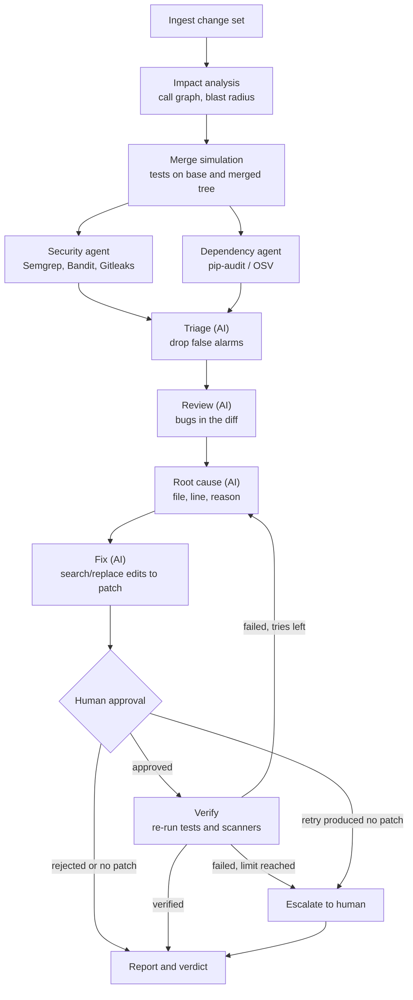
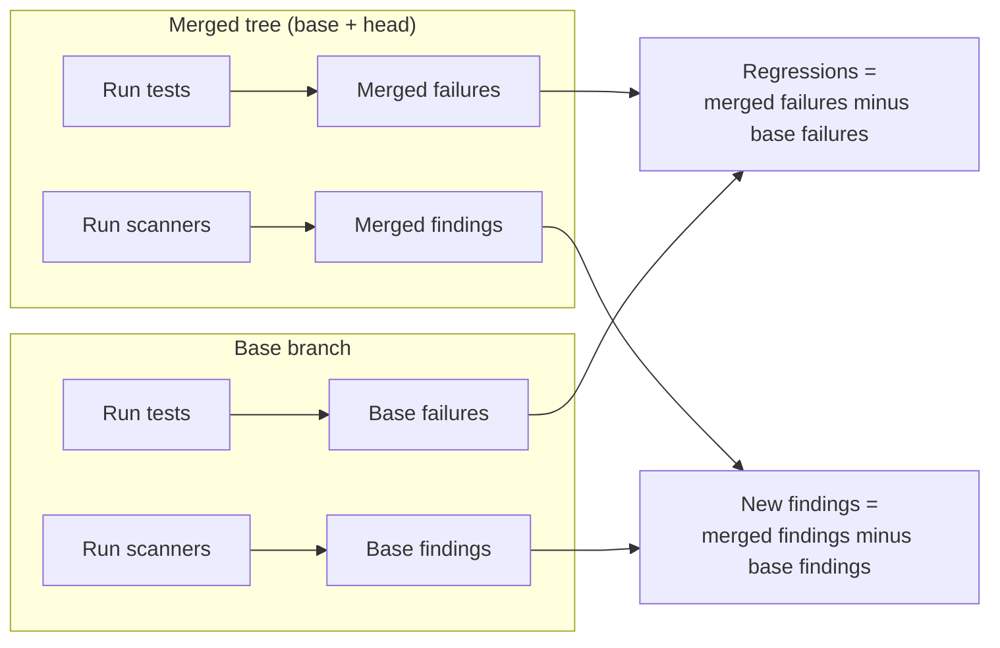
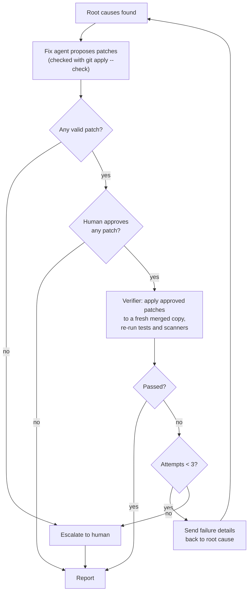
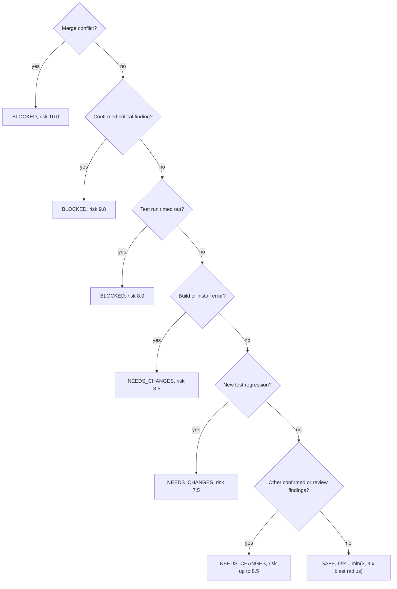

# AGAGI: Agentic Code Reviewer and Security Triage

AGAGI reviews a code change (a branch or pull request) the way a careful senior engineer would. It merges the change in a safe copy, runs the tests, scans for security problems, works out what else the change could break, explains the root cause of any problem, writes a fix, **waits for a human to approve it**, and then proves the fix works before reporting.

**Key idea:** tools decide the facts, the AI only explains and proposes. Tests and scanners (Semgrep, Bandit, Gitleaks, pip-audit/OSV) say what is wrong. The AI is used for four jobs only: triage, code review, root-cause analysis and writing fixes. Nothing is changed in your files without your approval.

Team: Smruthi Chandrashekar (ENG23AM0281), Sarthak Ramachandra (ENG23AM0185), Claudia Raj (ENG23AM0095).

Repository: [Sarthakr1003/AGAGI](https://github.com/Sarthakr1003/AGAGI)

---

## 1. What it does

| Stage | What happens |
|---|---|
| Ingest | Reads the branch/PR: changed files and diff |
| Impact | Builds a map of functions and callers (Tree-sitter + NetworkX) and scores the "blast radius" of the change |
| Merge simulation | Merges the branch into a throwaway copy, runs the tests there and on the base branch, and separates **new** failures from ones that already existed |
| Security + Dependency | Semgrep, Bandit and Gitleaks on the affected files; pip-audit/OSV on changed dependency files. Findings that already exist on the base branch are dropped (differential scanning) |
| Triage (AI) | Removes false alarms from the scanner results (top 15 by severity) |
| Review (AI) | Flags concrete bugs in the diff, and stays quiet on clean code |
| Root cause (AI) | Explains why a test or build failed, naming the file and line |
| Fix (AI) | Writes search/replace edits; AGAGI builds the patch from them and checks it with `git apply --check` |
| Approval | **Pauses.** A human picks which patches to approve |
| Verify | Applies only the approved patches in a throwaway copy, re-runs tests and scanners. If it fails, the failure is fed back and a new fix is tried (max 3 attempts), then escalated to a human |
| Report | Verdict `SAFE`, `NEEDS_CHANGES` or `BLOCKED` (or `ESCALATED` if the repair loop gave up), a risk score, a Markdown report and an audit trail |

10 agents in total. Only Triage, Review, Root cause and Fix use an AI model.

---

## 2. How it works

### 2.1 Review pipeline

The orchestrator ([core/orchestrator.py](core/orchestrator.py)) is a LangGraph state machine. Security and dependency scans run in parallel after merge simulation.



There are two ways to run it:

- **No-pause mode** (`run_review`, used by the main dashboard and the CLI): the approval step passes straight through. Nothing is applied or verified.
- **Approval mode** (`start_review` / `resume_review`, used by the Patch Approval page): the graph pauses at approval whenever patches exist, and approved patches are verified.

### 2.2 Differential testing and scanning

A pull request is only blamed for problems it introduces. Tests and scanners run on both the base branch and the merged code, and only the difference is reported.



Scanner findings are matched by file, rule and the text of the flagged line, not the line number, so code that only moved down the file still matches. If the base scan fails, every finding is kept.

### 2.3 Human approval and repair loop



A patch passes verification only if there are no regressions, the targeted findings are gone, and the scanners report nothing new. Retries never reuse a cached AI answer.

### 2.4 Verdict rules

The reporter ([agents/reporter_agent.py](agents/reporter_agent.py)) checks these rules in order and uses the first that matches.



If the repair loop escalated, the verdict becomes `ESCALATED` instead, and a human has to take over.

---

## 3. Setup (Windows, PowerShell)

You need **Python 3.11** (3.14 does not work yet because some libraries are not available for it) and **Git**.

```powershell
git clone https://github.com/SmruthiChandrashekar/AGAGI.git
cd AGAGI
python -m venv .venv
.\.venv\Scripts\activate
pip install -e ".[dev]"
```

On macOS or Linux, activate with `source .venv/bin/activate` instead.

### Install Semgrep (separately)

Semgrep conflicts with some of our other libraries, so it is installed on its own with pipx and not through `pip install -e`:

```powershell
pip install pipx
pipx install semgrep
pipx ensurepath
```

Close and reopen PowerShell afterwards. If Semgrep is missing, AGAGI still runs, but you get fewer security findings.

### Add your AI keys

```powershell
copy .env.example .env
```

Open `.env` and fill in:

- `GEMINI_API_KEY`: free at https://aistudio.google.com/apikey (about 20 requests per day per model on the free plan)
- `GROQ_API_KEY`: free at https://console.groq.com/keys (used as the backup when Gemini runs out)

Check that they work:

```powershell
python -m tools.check_llm
```

You want `[OK]` next to at least one provider. Without a working key, AGAGI falls back to simple built-in rules: root causes are weaker and no fixes are written. Placeholder values copied from `.env.example` do not count as keys. Retired model names from old `.env` files (for example `gemini-1.5-flash-latest`, `llama3-8b-8192`) are upgraded automatically.

Default models (change in `.env` if needed): `PRIMARY_MODEL=gemini/gemini-3.5-flash`, `FAST_MODEL=groq/openai/gpt-oss-20b`. The Ollama fallback model (`FALLBACK_MODEL=ollama/qwen2.5-coder:7b`) is optional.

> Never put a real key in `.env.example`. That file is committed to GitHub. `.env` is not.

---

## 4. Run the demo

### Build the sample project

```powershell
python tools/build_calc_demo.py --target C:\projects\calculator
```

Without `--target`, it builds a `calculator` folder next to the project folder. The repo has these branches, each reviewed against `main`:

| Branch | What it does | Expected verdict |
|---|---|---|
| `clean-merge` | Adds a harmless `multiply()` | SAFE |
| `breaks-test` | Adds a required parameter to `average()` and breaks existing tests | NEEDS_CHANGES (fix proposed) |
| `conflict` | Edits the same lines as `main` | BLOCKED (human must resolve) |
| `build-error` | Contains a Python syntax error | NEEDS_CHANGES (cause found) |
| `unsafe-eval` | Calls `eval()` on input | NEEDS_CHANGES (fix proposed) |
| `hardcoded-secret` | Contains a hard-coded AWS-style key | NEEDS_CHANGES, or BLOCKED if the model rates it critical |

### Start the dashboard

```powershell
python -m ui.server
```

Open http://127.0.0.1:8080.

- **Main dashboard:** review a local repository branch, or paste a GitHub personal access token to review your repositories' pull requests. Press Run Review and read the tabs (impact, security, test logs, diff, full report). This view never pauses and never changes anything.
- **Patch Approval page:** http://127.0.0.1:8080/approve. The review pauses when fixes are proposed. Tick the patches you accept, then press Approve selected (or Reject all). The Verifier tests them and shows **Verified**, or tries again.
- **Download the fix:** once a fix is verified, a **Download verified fix (.patch)** button appears. Apply it to your real project with:

```powershell
git apply agagi-fix.patch
```

Every approval, rejection, verification and escalation is recorded in `data/audit.db` (one run: `/api/review/<thread_id>/audit`).

### Command line

```powershell
agentreview review --repo C:\projects\calculator --base main --head breaks-test --output report.md
```

`python -m adapters.cli.main review ...` does the same. The CLI runs in no-pause mode: it prints or saves the report and never applies a fix. `agentreview ui` starts the dashboard.

---

## 5. Using it on a real project

AGAGI runs the target project's tests using the project's **own Python environment**, so its libraries are available.

1. In the project, create a virtual environment named `.venv` (or `venv` / `env`), install the project's requirements, and install `pytest` into it.
2. Point AGAGI at the project from the dashboard.

AGAGI picks the Python in this order, and only uses one that can import `pytest`: the `AGAGI_TARGET_PYTHON` variable, then the project's `.venv` / `venv` / `env`, then AGAGI's own Python.

Optional settings (PowerShell, set before starting the server):

```powershell
$env:AGAGI_TARGET_PYTHON = "C:\path\to\project\.venv\Scripts\python.exe"
$env:AGAGI_TEST_COMMAND  = "pytest -x tests/unit"   # replaces the detected test command
$env:AGAGI_TEST_TIMEOUT  = "180"                    # seconds per test run (default 45)
```

If Docker is installed, tests run in a locked-down container (no network, memory and CPU limits). Without Docker they run as a normal local process.

Other settings in `.env`: `MAX_FIX_ITERATIONS` (repair attempts before escalating, default 3) and `LOG_LEVEL`.

---

## 6. Tests and evaluation

### Unit tests

```powershell
python -m pytest
```

There are 85 tests. Use `python -m pytest`, not `pytest` alone. Add `--no-cov` to skip the coverage report. A full run takes about 10 minutes, and `tests/test_orchestrator.py` runs the whole pipeline, so it uses your AI keys if `.env` has them.

### Demo evaluation

Reviews every demo branch end to end with real AI and approves every fix:

```powershell
python -m eval.run_eval --repo C:\projects\calculator
```

It writes `eval/results/eval_results.json` and `eval/results/eval_report.md`. Our results on this 6-scenario suite, with every agent using `gpt-oss-120b` on Groq:

| Measure | Result |
|---|---|
| Correct verdict | 6 of 6 |
| Real issues found, root cause named, fix written and verified | 4 of 4 (all on the first attempt) |
| False alarms on clean code | 0 |
| AI call failures | 0 |
| Average time per review | 27.1 seconds |

These numbers are for our own test suite. They show the pipeline works end to end, and are not a claim of general accuracy on all code.

### Real-bug benchmark (BugsInPy)

[eval/run_bench.py](eval/run_bench.py) turns real Python bugs from [BugsInPy](https://github.com/soarsmu/BugsInPy) into two pull requests each: one that puts the bug back (should be flagged) and one that applies the developer's fix (should be SAFE). Only bugs that reproduce locally are used.

```powershell
python -m eval.run_bench prepare --projects tqdm --max-per-project 15
python -m eval.run_bench run --model groq/openai/gpt-oss-120b --configs full no_triage --limit 30
python -m eval.run_bench report --model groq/openai/gpt-oss-120b
```

Results go to `eval/results/bench/<model>/`. Finished runs are skipped, so `run` can be resumed after hitting a quota. Add `--no-cache` for independent repeats. A full run needs far more AI calls than the free plans allow; so far only pilot runs on tqdm bugs have been done.

### Ablations

To measure what each component contributes, switch it off with `AGAGI_ABLATIONS` (comma-separated), or pass the names to `--configs` in the benchmark:

| Name | What is switched off |
|---|---|
| `no_differential` | Base-branch test run (every failing test counts as a regression) |
| `no_diff_scan` | Base-branch scan (pre-existing scanner findings are reported) |
| `no_triage` | AI triage (every scanner finding is kept) |
| `no_feedback` | Verification feedback to root cause and fix on retries |
| `no_impact_context` | Changed functions from the impact graph in the root-cause prompt |

Leave `AGAGI_ABLATIONS` unset for normal use.

---

## 7. Project layout

```
adapters/    CLI and (planned) GitHub App entry points
agents/      the 10 agents (impact, merge simulation, security, dependency, triage,
             review, root cause, fix, verifier, reporter)
core/        orchestrator (LangGraph pipeline), shared state, AI client, audit log,
             config, ablation switches
indexer/     code parsing and call graph (Python)
tools/       wrappers for git, Docker, Semgrep, Bandit, Gitleaks, pip-audit/OSV,
             test environment, demo builder, AI key check
ui/          FastAPI server, dashboard, approval page
eval/        demo evaluation, BugsInPy benchmark, saved results
tests/       unit tests
```

---

## 8. Known limitations

- Code-structure analysis (call graph, blast radius) works for **Python only**. Other languages can still be tested and scanned.
- The dependency agent does not compare against the base branch yet.
- Differential scanning matches findings by the text of the flagged line, so a change that only reformats an existing weakness makes it look new.
- Reviews waiting for approval are kept in memory. Restarting the server forgets them.
- Approving a fix does not edit your project. You download the verified patch and apply it yourself.
- The GitHub App (automatic review of pull requests via webhook) is not built yet. The CLI has not been tested end to end, and its `--patch` option is not implemented.
- The free AI plans have daily request limits. When Gemini runs out, AGAGI uses Groq. If both run out, it falls back to simple rules.
- Code diffs are sent to the AI provider for triage, review and fixing. Do not use real keys or private code you are not allowed to share.
